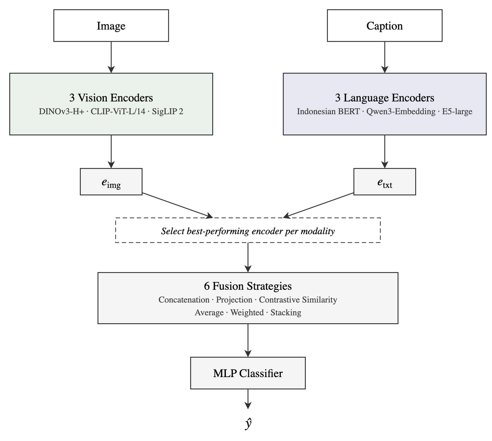

# Multimodal Deep Learning for Online Gambling Promotion Detection on Indonesian Social Media

Official code for the paper **["Multimodal Deep Learning for Online Gambling Promotion Detection on Indonesian Social Media"](https://doi.org/10.32665/statkom.v5i1.6412)** by Danish Rafie Ekaputra and Muhamad Syukron (Data Science Program, Department of Statistics, Institut Teknologi Sepuluh Nopember), published in *Jurnal Statistika dan Komputasi* 5(1), 41–60, 2026.

[Paper](https://doi.org/10.32665/statkom.v5i1.6412) · [Dataset (Hugging Face)](https://huggingface.co/datasets/0xRafie/indonesian-gambling-multimodal-dataset)

This code is for research on **detecting and filtering** gambling promotions for content moderation. It does not promote gambling.



## Overview

We collected 5,028 image-caption posts from Facebook, TikTok and X (2,195 gambling promotions, 2,833 non-promotions). Each post is encoded by frozen pretrained encoders, and a small MLP is trained on top:

1. **Image only**: DINOv3-H+, CLIP-ViT-L/14-336, SigLIP 2 So400m/14-384.
2. **Text only**: Indonesian BERT (Cahya), Qwen3-Embedding-0.6B, Multilingual E5-large.
3. **Multimodal**: the best encoders (SigLIP 2 + E5-large) combined with six fusion strategies: concatenation (early); projection and contrastive similarity (intermediate); average, weighted and stacking (late).

## Repository structure

```
gamblingdet/            library code
  config.py             hyperparameters and encoder registry
  data.py               dataset loading and the 70/10/20 split
  embeddings.py         frozen-encoder feature extraction
  models.py             MLP head and the six fusion models
  engine.py             training loops and metrics
extract_embeddings.py   step 1: cache embeddings for all samples
train_unimodal.py       step 2: image-only / text-only experiments
train_fusion.py         step 3: fusion experiments
evaluate.py             evaluate a saved checkpoint on the test split
splits/                 sample ids of the exact train/val/test split used in the paper
scripts/                data download, full reproduction, split regeneration
tests/                  CPU smoke tests
```

## Requirements

Python 3.12 and a CUDA GPU for embedding extraction (the MLP heads train in seconds on a CPU).

```bash
git clone https://github.com/0xRafie/multimodal-gambling-detection.git
cd multimodal-gambling-detection
python -m venv .venv && source .venv/bin/activate
pip install -r requirements.txt
```

DINOv3 is a gated model. Accept its licence on the [model page](https://huggingface.co/facebook/dinov3-vith16plus-pretrain-lvd1689m) and log in with `hf auth login` before extracting its embeddings.

## Data

```bash
bash scripts/download_data.sh        # -> data/dataset.csv and data/image/
```

`dataset.csv` columns: `id`, `text_caption`, `image_path`, `platform`, `label` (1 = gambling promotion, 0 = non-promotion). See the [dataset card](https://huggingface.co/datasets/0xRafie/indonesian-gambling-multimodal-dataset) for collection and labelling details.

The split is stratified by label: 20% test is held out first, then the rest is split into 70% train and 10% validation (seed 66), giving 3,519 / 503 / 1,006 samples. The ids are stored in `splits/` so the split does not depend on your scikit-learn version; `scripts/make_splits.py` regenerates them.

## Reproducing the paper

Run everything with:

```bash
bash scripts/reproduce_paper.sh
```

or step by step:

```bash
# 1. Embeddings (cached in embeddings/<modality>_<encoder>.npz)
python extract_embeddings.py --modality image --encoders dinov3 clip siglip2
python extract_embeddings.py --modality text  --encoders indobert qwen3 e5

# 2. Unimodal heads (Tables 4 and 5)
python train_unimodal.py --modality image --encoder siglip2
python train_unimodal.py --modality text  --encoder e5

# 3. Fusion strategies on SigLIP 2 + E5-large (Table 6)
python train_fusion.py
```

Each run writes a checkpoint to `outputs/checkpoints/`, per-sample test predictions to `outputs/predictions/`, and metrics plus loss history to `outputs/results/`.

### Training details

| Setting | Value |
|---|---|
| Classifier head | Linear(d, 128), ReLU, Dropout 0.3, Linear(128, 1) |
| Loss / optimiser | BCE with logits, Adam, learning rate 1e-3 |
| LR schedule | ReduceLROnPlateau, factor 0.5, patience 3 |
| Batch size / max epochs | 32 / 50 |
| Decision threshold | 0.5 |
| Fusion projection dimension | 512 |
| Contrastive temperature | learnable, initialised to 1/0.07 |

- **Unimodal**: (1) train on the train split with early stopping on validation loss (patience 5) and report validation metrics; (2) retrain from scratch on train + validation for a fixed 50 epochs and report test metrics. Phase 2 has no validation set, so the LR schedule never fires and the learning rate stays at 1e-3.
- **Fusion**: train on the train split, keep the weights with the best validation F1 (early stopping patience 5, LR schedule on validation F1), then evaluate once on the test split.
- Every experiment starts from seed 66. GPU kernels and library versions can still move results slightly.

## Pre-trained models

The trained MLP heads are attached to the [v1.0 release](https://github.com/0xRafie/multimodal-gambling-detection/releases/tag/v1.0). Put them in `checkpoints/`, extract the matching embeddings, and run:

```bash
python evaluate.py --checkpoint checkpoints/text_e5.pt
```

| Checkpoint | Encoder | Test F1 |
|---|---|---|
| `image_clip.pt` | CLIP-ViT-L/14-336 | 92.74 |
| `image_siglip2.pt` | SigLIP 2 | 93.52 |
| `text_indobert.pt` | Indonesian BERT (Cahya) | 94.49 |
| `text_qwen3.pt` | Qwen3-Embedding-0.6B | 94.04 |
| `text_e5.pt` | Multilingual E5-large | 95.89 |

The DINOv3 head is not included; `train_unimodal.py --modality image --encoder dinov3` recreates it in a few seconds once its embeddings exist.

## Results

Test set (1,006 posts). All values in %.

**Image only**

| Encoder | Recall | Precision | F1 | Accuracy |
|---|---|---|---|---|
| DINOv3-H+ | 90.66 | 88.84 | 89.74 | 90.95 |
| CLIP-ViT-L/14-336 | 93.17 | 92.33 | 92.74 | 93.64 |
| SigLIP 2 | 92.03 | 95.06 | **93.52** | **94.43** |

**Text only**

| Encoder | Recall | Precision | F1 | Accuracy |
|---|---|---|---|---|
| Indonesian BERT (Cahya) | 91.80 | 97.34 | 94.49 | 95.33 |
| Qwen3-Embedding-0.6B | 93.39 | 94.69 | 94.04 | 94.83 |
| Multilingual E5-large | 95.67 | 96.11 | **95.89** | **96.42** |

**Multimodal (SigLIP 2 + E5-large)**

These values come from the archived run of this code; its confusion matrix is the one shown in the paper (419 TP, 555 TN, 12 FP, 20 FN for Contrastive Similarity). Table 6 of the paper contains a transcription error.

| Fusion | Recall | Precision | F1 | Accuracy |
|---|---|---|---|---|
| Concatenation | 93.17 | 95.78 | 94.46 | 95.23 |
| Average | 94.99 | 94.56 | 94.77 | 95.43 |
| Weighted | 94.08 | 96.05 | 95.05 | 95.73 |
| Stacking | **95.90** | 94.61 | 95.25 | 95.83 |
| Projection | **95.90** | 96.34 | 96.12 | 96.62 |
| Contrastive Similarity | 95.44 | **97.22** | **96.32** | **96.82** |

## Tests

```bash
pytest -q                               # CPU, about 30 seconds
GD_DATA_DIR=data pytest -q              # also checks that the split regenerates exactly
```

## Citation

```bibtex
@article{ekaputra2026multimodal,
  title   = {Multimodal Deep Learning for Online Gambling Promotion Detection on Indonesian Social Media},
  author  = {Ekaputra, Danish Rafie and Syukron, Muhamad},
  journal = {Jurnal Statistika dan Komputasi},
  volume  = {5},
  number  = {1},
  pages   = {41--60},
  year    = {2026},
  doi     = {10.32665/statkom.v5i1.6412}
}
```

## License

- **Code**: [MIT](LICENSE).
- **Pre-trained heads** (release assets): [CC BY-NC 4.0](https://creativecommons.org/licenses/by-nc/4.0/), for non-commercial research only, because they were trained on third-party social-media content.
- **Dataset**: has its own terms; see the [dataset card](https://huggingface.co/datasets/0xRafie/indonesian-gambling-multimodal-dataset). The images and captions belong to their original owners.

## Acknowledgements

The encoders come from [DINOv3](https://huggingface.co/facebook/dinov3-vith16plus-pretrain-lvd1689m), [CLIP](https://huggingface.co/openai/clip-vit-large-patch14-336), [SigLIP 2](https://huggingface.co/google/siglip2-so400m-patch14-384), [Indonesian BERT](https://huggingface.co/cahya/bert-base-indonesian-1.5G), [Qwen3-Embedding](https://huggingface.co/Qwen/Qwen3-Embedding-0.6B) and [Multilingual E5](https://huggingface.co/intfloat/multilingual-e5-large).
